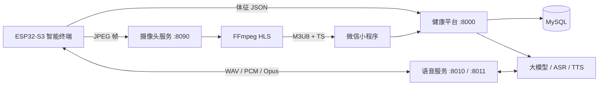

# 智守云伴（Smart Elderly Guardian）

面向居家养老场景的物联网健康监护原型。规划由 ESP32-S3 终端采集生命体征、图像和语音，后端完成数据持久化、异常判断、摄像头转码、AI 健康问答与语音交互，微信小程序作为家属端入口。

> 当前仓库首先收录已经交付的后端代码。`frontend/` 和 `hardware/` 已预留协作目录，等待对应同学通过独立分支提交。仓库中的健康建议仅用于项目演示，不能替代医生诊断。

## 当前状态

| 模块 | 状态 | 入口与证据 |
|---|---|---|
| 健康数据/AI 后端 | 已有可测试源码 | [`backend/health-platform/app.py`](backend/health-platform/app.py)、[模块说明](backend/health-platform/README.md) |
| 摄像头/HLS/云台后端 | 已有源码和测试 | [`backend/camera-stream-server`](backend/camera-stream-server)、[模块说明](backend/camera-stream-server/README.md) |
| HTTP 整段/流式语音 | 已有源码和测试 | [`backend/voice-service/app.py`](backend/voice-service/app.py)、[模块说明](backend/voice-service/README.md) |
| 实时 PCM / Opus 语音 | 实验性双方案，端口不可同时占用 | [`realtime_gateway`](backend/voice-service/realtime_gateway)、[`opus_gateway`](backend/voice-service/opus_gateway) |
| 微信小程序 | 等待前端同学提交 | [`frontend/wechat-miniprogram`](frontend/wechat-miniprogram) |
| ESP32 固件与硬件资料 | 等待硬件同学提交 | [`hardware`](hardware) |

## 系统数据流



## 仓库结构

```text
smart-elderly-guardian/
├── frontend/
│   └── wechat-miniprogram/       # 微信小程序（待前端提交）
├── backend/
│   ├── health-platform/          # Flask：传感数据、AI 问答、健康周报
│   ├── camera-stream-server/     # Spring Boot：JPEG、HLS、云台控制
│   └── voice-service/            # Flask/aiohttp：HTTP、PCM、Opus 语音链路
├── hardware/
│   ├── firmware/                 # ESP32 固件（待硬件提交）
│   ├── enclosure/                # 外壳/结构设计
│   └── protocols/                # 硬件通信协议
├── docs/                         # 跨模块设计与部署文档
├── scripts/                      # 部署和诊断脚本
├── archive/                      # 仅保存明确标注的历史材料
└── CONTRIBUTING.md               # 团队 Git 操作步骤
```

## 后端快速开始

### 1. 健康平台

依赖 Python、MySQL。复制配置示例并填写本机配置，真实密钥不要提交：

```bash
cd backend/health-platform
python -m venv .venv
# Windows: .venv\Scripts\activate
# Linux/macOS: source .venv/bin/activate
pip install -r requirements.txt
cp health-platform.env.example .env
python app.py
```

默认端口 `8000`。主要接口为 `POST /api/upload-data`、`GET /api/get-latest-data`、`POST /api/ai-chat` 和 `GET|POST /api/reports/weekly`。数据库需包含代码使用的 `sensor_data` 表；后续应补充正式 migration/初始化 SQL。

### 2. 摄像头流媒体服务

依赖 JDK 17、Maven 和 FFmpeg：

```bash
cd backend/camera-stream-server
mvn spring-boot:run
```

默认端口 `8090`。上传入口为 `POST /api/cameras/{cameraId}/frame`，播放入口为 `GET /api/live/{cameraId}.m3u8`。启动生产环境前必须替换默认的上传、观看和控制 Token。

### 3. AI 语音服务

```bash
cd backend/voice-service
python -m venv .venv
pip install -r requirements.txt
python app.py
```

HTTP 服务默认监听 `8010`。`realtime_gateway` 与 `opus_gateway` 默认都使用 `8011`，它们是两套候选实现，不能在同一主机同一端口同时启动；团队需要在联调后明确生产选型或修改其中一个端口。

## 测试

```bash
cd backend/health-platform
python -m unittest -v

cd ../camera-stream-server
mvn test

cd ../voice-service
python -m unittest -v
```

部分语音端到端脚本会访问第三方服务，需要本地配置密钥，不应在无凭据环境直接运行。

## 团队协作

前端和硬件同学不需要把文件发给后端同学代传。每个人克隆同一个仓库、创建自己的功能分支，只修改所属目录，然后通过 Pull Request 合并。可直接把 [`CONTRIBUTING.md`](CONTRIBUTING.md) 发给同学照着操作。

基本原则：

- 前端只将微信小程序源码放入 `frontend/wechat-miniprogram/`；
- 硬件固件按功能放入 `hardware/firmware/`，协议放入 `hardware/protocols/`；
- 禁止提交 API Key、Token、Wi-Fi 密码、数据库密码和个人配置；
- 禁止提交 `node_modules`、`target`、编译产物、FFmpeg 二进制和大型演示视频；
- 跨模块接口变化必须同步更新文档，并通过 Pull Request 审核。

## 安全提醒

示例配置中的 `CHANGE_ME` 必须在部署时替换。公开仓库中不要出现生产公网地址、真实老人数据、录音、图像或联系方式。如果某个密钥曾经进入 Git 历史，仅删除文件是不够的，应立即在供应商控制台废止并重新生成。

## 路线图

- [ ] 前端同学提交小程序并完成健康、摄像头、告警页面
- [ ] 硬件同学提交可编译固件、引脚表和烧录说明
- [ ] 增加 MySQL schema/migration
- [ ] 统一设备 ID、鉴权头和错误响应格式
- [ ] 在 PCM 与 Opus 实时语音方案中确定生产方案
- [ ] 增加 CI：Python 单元测试、Maven 测试和密钥扫描
- [ ] 将生产地址全部改为环境变量或示例域名
