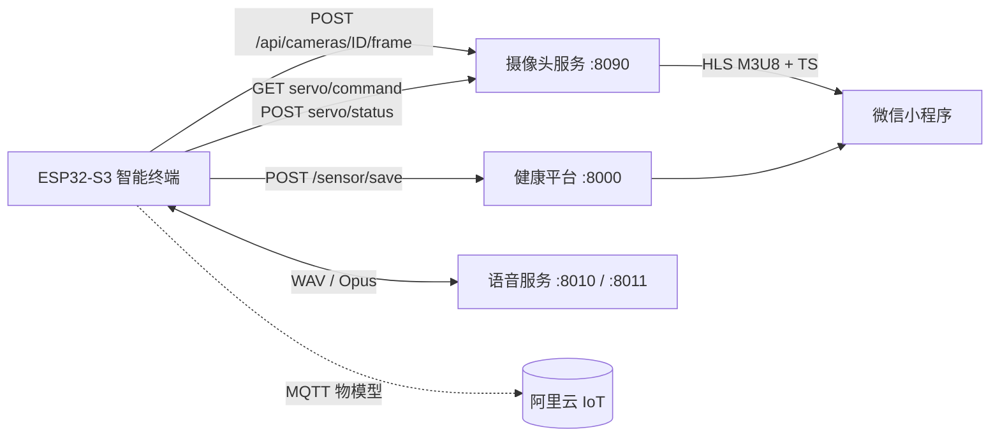

# 硬件

ESP32-S3 智能终端：体征采集、摄像头推流、云台随动、双向语音、云端上报，全部跑在一块板子上。

本目录存放**可重新编译的固件源码**、设备与后端的通信协议、结构装配资料。

 Git 提交步骤见 [`CONTRIBUTING.md`](../CONTRIBUTING.md)。

## 目录

| 路径 | 内容 |
|---|---|
| [`firmware/smart-terminal/`](firmware/smart-terminal/) | 固件工程（ESP-IDF 5.2.2，目标 esp32s3） |
| [`firmware/README.md`](firmware/README.md) | 编译、烧录、组件策略 |
| [`protocols/`](protocols/) | 设备与后端的契约：URL、请求头、字段、错误码、重试 |
| [`enclosure/`](enclosure/) | 外壳、装配步骤、物料清单 |
| [`PIN_MAP.md`](PIN_MAP.md) | 全部引脚、保留引脚、电源与接线注意事项 |
| [`tools/`](tools/) | 引脚冲突自检脚本 |

## 模块与后端对应关系

| 能力 | 固件模块 | 后端服务 | 端口 |
|---|---|---|---|
| 体征上报 | `dht11.c`、`max30102.c`、`main.c` | `backend/health-platform` | 8000 |
| 摄像头推流 | `camera.c` | `backend/camera-stream-server` | 8090 |
| 云台随动 | `servo.c` | 同上（servo 接口） | 8090 |
| 双向语音 | `voice_*.c` | `backend/voice-service` | 8010 / 8011 |
| 物模型上报 | `mqtt_aliot.c`、`aliot_dm.c` | 阿里云 IoT（可选） | 8883 |



## 硬件清单

完整 BOM（封装、数量、备注）见 [`enclosure/BOM.csv`](enclosure/BOM.csv)。核心器件：

- 主控：ESP32-S3（**8 MB Flash + 八线 PSRAM**，摄像头帧缓冲必需）
- 视觉：OV2640 DVP 摄像头模组；SG90 云台舵机
- 体征：MAX30102（I²C）、DHT11（单总线）
- 语音：INMP441（I²S 麦克风）、MAX98357A（I²S 功放）
- 指示：WS2812 RGB LED
- 供电：5 V/2 A，舵机与功放独立支路

## 快速开始

```bash
cd hardware/firmware/smart-terminal
copy main\config.example.h main\config.local.h    # 填入 Wi-Fi、服务器地址、Token
idf.py set-target esp32s3
idf.py build
idf.py -p COM3 flash monitor
```

环境要求（ESP-IDF v5.2.2、CMake 3.16+、组件版本）见 [`firmware/README.md`](firmware/README.md)。

## 当前状态

| 项目 | 状态 |
|---|---|
| 固件源码 | 可编译（ESP-IDF 5.2.2 构建通过，镜像约 1.12 MB / 1.5 MB 分区） |
| 协议文档 | 与后端现有实现逐条对齐，待后端同学评审 |
| 引脚表 | 已按代码与实物接线整理，见 `PIN_MAP.md` |
| 实机验证 | 体征、摄像头、云台已联调；**Opus WebSocket 语音链路未完成端到端验证**（默认关闭） |
| 外壳 | 装配方案与 BOM 已提交，`stl/` 待补充 |

## 安全红线

**禁止提交：**

- Wi-Fi SSID / 密码
- `DEVICE_STREAM_INGEST_TOKEN`、`DEVICE_VOICE_TOKEN`、`DEVICE_HEALTH_TOKEN`
- 阿里云 `ProductKey` / `DeviceName` / `DeviceSecret`
- 生产服务器公网地址
- 真实用户数据（录音、图像、体征原始记录）
- `.pio/`、`build/`、`sdkconfig`、`managed_components/`、`*.bin`、`*.elf`

**正确做法：**

| 该做的事 | 原因 |
|---|---|
| 仓库只放 `main/config.example.h`，真实值写 `main/config.local.h` | `hardware/.gitignore` 已忽略后者 |
| 提交前执行 `git grep -n -I -E "API_KEY\|PASSWORD\|TOKEN\|SECRET"` | 只应命中 `CHANGE_ME` 与变量名 |
| 用 `git status` 确认 `config.local.h` 不在待提交列表 | 一次误提交就要废止并重发全部令牌 |
| 令牌一旦进过 Git 历史，去服务端废止重发 | 只删文件没用，历史里还在 |

## 协作边界

- 硬件只改 `hardware/`；`protocols/` 是跨模块契约，改动前先在群里说一声
- 根 `README.md`、`.gitignore`、`docs/` 属于公共文件，同样先沟通
- 不用 `git push --force` 覆盖公共分支
- 协议改动必须和对应后端的 PR 一起提交，否则设备端与服务器会各说各话
